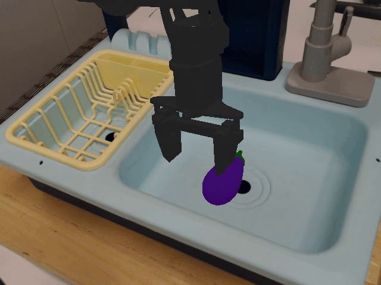
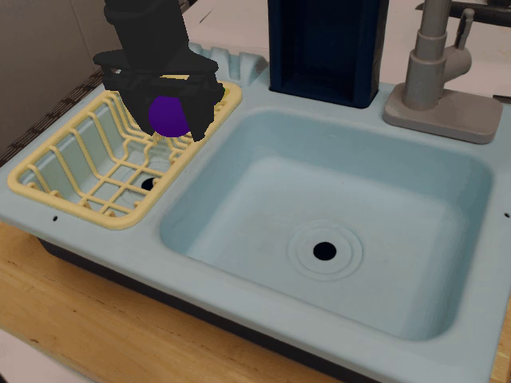
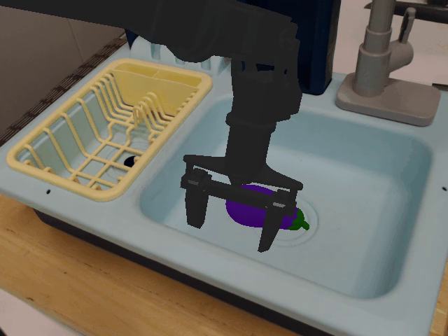
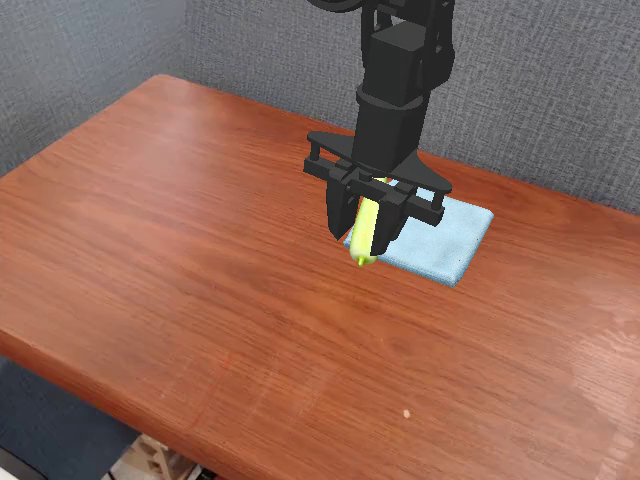
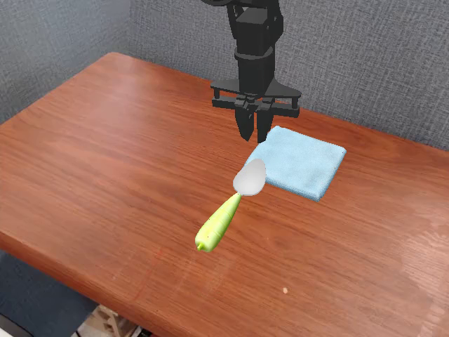
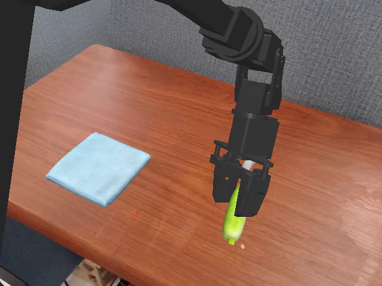

# 机器学习课程大作业实验报告

B 类：OpenVLA-7B 的三次 LoRA 微调与 SimplerEnv WidowX 闭环评测。2026-10-24。

**项目类别：** B 类（工程实践型）  
**完成方式：** 个人独立完成。姓名与学号在提交系统中填写。  
**代码仓库：** <https://gitee.com/karlshaus/vlalora>

## 1. 项目概述

本实验以公开模型 OpenVLA-7B 为 Base，在 BridgeData V2 子集上完成三次 LoRA 微调，并在 SimplerEnv 的 WidowX Visual Matching 设置中比较闭环表现。三次训练分别记为 v1、v2、v3。每次训练内部的 checkpoint 只按验证集动作 token 损失保存。提交用的 Final 是 v3 的 step 300。

正式对比包含两个任务：

- T1：`widowx_spoon_on_towel`，把勺子放到毛巾上；
- T2：`widowx_put_eggplant_in_basket`，把茄子放进黄色篮子。

Base、v1、v2、v3 使用同一份评测脚本和同一组正式初始状态，每个模型每个任务 10 个 episode，共 80 个 episode。结果如下。

| 模型 | T1 | T2 | B-SimplerScore |
| --- | ---: | ---: | ---: |
| Base | 1/10 | 1/10 | 10.0 |
| v1 | 0/10 | 0/10 | 0.0 |
| v2 | 0/10 | 2/10 | 10.0 |
| v3（Final） | 0/10 | 5/10 | 25.0 |

相对 Base，v1 下降 10.0 个百分点，v2 持平，v3 上升 15.0 个百分点。提升集中在 T2。每个任务只有 10 次，这个差距还不能当成稳定优势。

## 2. 模型与动作接口

OpenVLA-7B 把视觉编码器和 Llama-2-7B 连接起来，把连续动作离散成 256 个 token，再按自回归方式预测 7 维动作。本地目录是 `models/openvla-7b`，对应公开 checkpoint `openvla/openvla-7b`。配置里的 `norm_stats` 含有 `bridge_orig`，即 Bridge 数据的动作分位数。BridgeData V2 由 WidowX 250 采集，因此该 checkpoint 满足“已经用 WidowX 数据训练”的要求。OpenVLA 论文报告了该模型在 OXE（含 Bridge）上的训练，并给出 SimplerEnv 评测。

选择它有三点原因。公开权重自带 Bridge 的 q01/q99 统计，推理时使用 `unnorm_key=bridge_orig`。LoRA 只更新语言模型的一部分参数。输出是单步 7 维动作，可以接到 WidowX 的末端增量控制上。

动作适配写在 `scripts/evaluate_openvla_widowx.py`，四次评测使用的是同一版本。相机画面用 Lanczos 缩到 256×256。模型输出的前三维作为平移增量；第 4 到第 6 维按欧拉角增量转换成 WidowX 控制器使用的轴角；第 7 维以 0.5 为阈值二值化，大于等于 0.5 映射为环境命令 +1，否则映射为 −1。v2 和 v3 的成功轨迹里夹爪确实闭合，环境也记录到抓取。

推理由 `scripts/serve_openvla.py` 加载合并后的权重，`do_sample=False`。Base 与三个微调模型在独立进程中分别加载。

## 3. 数据与处理

训练数据来自 BridgeData V2 的官方 RLDS 发布，许可为 CC BY 4.0。完整数据约 124GB。实验用种子 42 从 Berkeley 发布的 `bridge_dataset/1.0.0` 抽取子集。

第一份子集是 60 个训练分片和 12 个验证分片，共 7.756GiB，包含 3,756 条轨迹、141,289 个时间步。语言筛选保留“放到表面”和“放入容器”两类，得到官方训练集 548 条轨迹、官方验证集 128 条轨迹。划分沿用官方 split，按整条轨迹分开。

v1 直接使用这 548 条训练轨迹的全部时间步，共 18,639 步；验证使用对应 128 条轨迹的 4,267 步。v1 不按关键词删轨迹，也不删静止帧。

v2 和 v3 在此之上使用 `scripts/finetune_openvla_bridge.py` 里的两级过滤。第一级看整条轨迹：取第一步的 `language_instruction`，转成小写后必须包含 spoon、towel、eggplant、basket 之一。不包含则整条轨迹丢弃。第一份子集因此从 548 条训练轨迹剩下 88 条，从 128 条验证轨迹剩下 20 条。这些轨迹里没有完整的 “eggplant → basket” 示范，T2 相关样本主要来自茄子进入其他容器，以及其他物体进入篮子。

第二级在留下的轨迹内部逐时间步判断。动作是 7 维，前 3 维为平移，中间 3 维为旋转，最后 1 维为夹爪。一个时间步保留，只要满足下面任意一条：

- 平移的欧氏范数至少 0.005；
- 旋转三维的欧氏范数至少 0.02；
- 夹爪相对轨迹中紧邻的上一个时间步变化至少 0.5。

三条都不满足就记为静止帧并丢弃。第一条时间步没有上一帧，只能靠平移或旋转保留。被丢弃的帧仍作为下一帧的“上一帧”，所以夹爪变化是和原始轨迹的相邻帧比较，不是和上一个被保留的训练样本比较。实现函数是 `keeps_motion`，阈值对应参数 `--min-xyz 0.005` 和 `--min-rotation 0.02`。

按这套规则，第一份子集保留 2,580 个训练步和 535 个验证步，训练侧另丢弃 449 个静止帧。v3 再追加第二份数据：种子 42 从未使用的官方训练分片中抽 80 片，共 8.527GiB，只进入训练集。其中关键词轨迹 330 条，运动筛选后保留 10,222 步，丢弃 1,645 个静止帧。v3 的训练样本因此是 12,802 步，来自 418 条轨迹；验证集仍是原来的 535 步。

三次训练的样本规模如下。

| 版本 | 训练轨迹 | 训练步 | 验证轨迹 | 验证步 | 数据规则 |
| --- | ---: | ---: | ---: | ---: | --- |
| v1 | 548 | 18,639 | 128 | 4,267 | 表面放置与容器放置的全部时间步 |
| v2 | 88 | 2,580 | 20 | 535 | 再要求四个关键词，并去掉静止帧 |
| v3 | 418 | 12,802 | 20 | 535 | v2 的样本，加上 330 条额外关键词轨迹 |

字段对应关系如下。

- `observation.image_0` 作为 RGB 图像。训练时先存成 JPEG，推理时再送入 OpenVLA 图像处理器。
- `language_instruction` 写成 `In: What action should the robot take to {instruction}?`。
- `action` 是 7 维动作 token。前 6 维用 `bridge_orig` 的 q01/q99 归一化到 [−1, 1]，夹爪维保持原始 0/1。

`bridge_orig` 的动作 mask 为 `[True, True, True, True, True, True, False]`。一个检查样本是训练轨迹 6：指令为 “take the spoon from the left bottom burner and put it in the cooking pot”，图像为 256×256×3。该帧平移接近 0、夹爪为 1，属于静止帧，v2 和 v3 会把它去掉，v1 会保留。图像在 `artifacts/data_report/sample_image.png`。分片和轨迹清单在 `artifacts/data_report/` 与 `artifacts/openvla_bridge_split/`。

正式评测的初始状态没有进入训练数据。训练轨迹来自 Bridge 遥操作记录，评测轨迹由 SimplerEnv 按独立种子生成。

## 4. 三次微调

三次训练都从同一个 Base 开始，优化器都是 AdamW，有效 batch 都是 8，梯度裁剪为 1.0，随机种子为 42。基座权重和前向计算使用 bfloat16。v2 与 v3 的 LoRA 权重使用 float32。视觉骨干和投影层冻结。每次只保留验证损失按预定规则刷新的 adapter，再合并成独立目录供评测加载。SimplerEnv 成功率不参与选 checkpoint。设备是一张 NVIDIA GeForce RTX 4090。

v1 的验证集有 4,267 步，v2 和 v3 的验证集有 535 步。两边的损失数值不能直接比高低，只能在同一次训练内部比较。三次的超参数和选出的 checkpoint 写在下面各节里。

### 4.1 v1

v1 用 rank 32、alpha 16 的 LoRA 覆盖 `q_proj`、`k_proj`、`v_proj`、`o_proj`、`gate_proj`、`up_proj` 和 `down_proj`，缩放系数为 0.5。可训练参数 79,953,920，占总参数的 1.049%。学习率 5e-4，没有 warmup。数据不做关键词和静止帧筛选。计划 800 步，每 100 步验证，验证损失创新低就保存。

日志在 `logs/openvla_bridge_lora.jsonl`。验证损失从 step 100 的 3.059 降到 step 800 的 3.011。step 300 到 600 没有再创新低，step 700 和 800 又略有下降。训练跑满 800 步，用时 1,861 秒。按“验证损失最低”的规则，采用 step 800，合并到 `models/openvla-7b-bridge-lora`。配置在 `checkpoints/openvla_bridge_lora/train_config.json`。

### 4.2 v2

v2 把可训练范围收回到 `q_proj` 和 `v_proj`。rank 为 8，alpha 为 16，缩放系数为 2。可训练参数 4,194,304，占总参数的 0.0556%。学习率 1e-4，前 50 步 warmup。训练样本是 2,580 个关键词运动帧。验证样本固定为 64 个，每 25 步验证一次。若验证损失没有比当前最好值低出 0.02，就记一次停滞；连续 4 次则早停。这次在 300 步计划内没有触发早停，用时 576 秒。

验证损失在 step 175 为 3.520，step 225 降到 3.482 并保存。step 275 的 3.468 更低，但相对 3.482 只改进了 0.013，没有替换已保存的 adapter。因此 v2 的评测权重是 step 225，合并到 `models/openvla-7b-bridge-lora-v2`。日志在 `logs/openvla_bridge_lora_v2.jsonl`。

### 4.3 v3

v3 保持 v2 的网络、学习率、rank、可训练参数量和验证规则，只把训练集扩大到 12,802 步。计划步数改为 1,200，每 50 步验证。验证损失依次为：step 50 为 7.841，step 100 为 3.650，step 150 为 3.530，step 200 为 3.504，step 300 为 3.478。step 250 的 3.484 和 step 350 的 3.466 都没有比当时的最好值低出 0.02，所以没有保存。step 400 到 500 连续四次未达标，训练在 step 500 停止，用时 888 秒。

按这条预先写好的规则，v3 也就是 Final，采用 step 300，验证损失 3.478。日志在 `logs/openvla_bridge_lora_v3.jsonl`，配置在 `checkpoints/openvla_bridge_lora_v3/train_config.json`。

## 5. 评测设置

| 项目 | 设置 |
| --- | --- |
| SimplerEnv | 本地提交 `eddb5690749a1e34267807c0f7b5eede323918d7` |
| ManiSkill2_real2sim | `ef7a4d4fdf4b69f2c2154db5b15b9ac8dfe10682` |
| 任务设置 | WidowX Visual Matching，由 `simpler_env.make` 创建 |
| 控制频率 | 5 Hz |
| 最大控制步数 | 60 |
| 模型随机性 | `do_sample=False`，记录为 greedy |
| 成功判定 | 环境返回的 success；超时 `truncated` 记为失败 |
| 人工干预 | 无；失败 episode 保留 |

开发阶段用过 T1 种子 1100–1109 和 T2 种子 2200–2209。正式结果不使用那一组。下面的四模型对比使用预先固定的下一组种子：T1 为 1110–1119，T2 为 2210–2219，写在 `config/eval_states_b_formal.json`。清单没有按成功率删减。

四次评测由 `scripts/run_b_unified.sh` 调用同一脚本 `scripts/evaluate_openvla_widowx.py`。图像缩放、欧拉角到轴角的转换、夹爪阈值、控制频率和步数上限保持一致。结果目录是 `results/b_unified/{base,v1,v2,v3}`。80 个 episode 的异常字段均为空。Base 与 v3 的逐条成败和早先单独保存的 `results/b_formal` 一致。

## 6. 实验结果

| 模型 | 训练模块 | T1 成功数 | T2 成功数 | B-SimplerScore |
| --- | --- | ---: | ---: | ---: |
| Base | 未进行本次微调 | 1/10 | 1/10 | 10.0 |
| v1 | rank 32，七个投影层 | 0/10 | 0/10 | 0.0 |
| v2 | rank 8，`q_proj` 与 `v_proj` | 0/10 | 2/10 | 10.0 |
| v3 / Final | 同 v2 的模块，数据更多 | 0/10 | 5/10 | 25.0 |

相对 Base 的 B-SimplerScore 变化：v1 为 −10.0 个百分点，v2 为 0.0 个百分点，v3 为 +15.0 个百分点。T1 上三个微调版本都是 0/10，Base 的唯一成功在种子 1119。T2 上 Base 成功于种子 2211；v2 成功于 2211 和 2219；v3 成功于 2210、2211、2213、2218、2219。v2 的两次成功都用了 56 步。v3 的五次成功用了 41、36、41、45、30 步，平均 38.6 步。这个平均只统计成功轨迹。

过程统计如下。抓取表示 `is_src_obj_grasped`，连续抓取表示 `consecutive_grasp`，放到目标上表示 `src_on_target`。

| 模型与任务 | 成功 | 曾抓取 | 连续抓取 | 移动了正确物体 | 物体在目标上 |
| --- | ---: | ---: | ---: | ---: | ---: |
| Base，T1 | 1/10 | 3/10 | 2/10 | 4/10 | 1/10 |
| Base，T2 | 1/10 | 4/10 | 4/10 | 6/10 | 1/10 |
| v1，T1 | 0/10 | 0/10 | 0/10 | 0/10 | 0/10 |
| v1，T2 | 0/10 | 0/10 | 0/10 | 0/10 | 0/10 |
| v2，T1 | 0/10 | 4/10 | 2/10 | 5/10 | 0/10 |
| v2，T2 | 2/10 | 2/10 | 2/10 | 7/10 | 2/10 |
| v3，T1 | 0/10 | 4/10 | 1/10 | 5/10 | 0/10 |
| v3，T2 | 5/10 | 5/10 | 5/10 | 7/10 | 5/10 |

有证据的观察有四条。

1. v1 的 20 个 episode 全部跑满 60 步。平均平移幅度都是 4.46e-5，夹爪闭合比例都是 0，没有一次移动正确物体。在这组正式状态下，v1 几乎没有产生有效末端运动。
2. v2 在 T2 上两次连续抓取都完成了放入篮子，另外五次移动了茄子但没有形成成功放置。T1 上有四次抓取，没有一次放到毛巾上。
3. v3 在 T2 上每一次连续抓取都完成了放入篮子，成功数从 Base 的 1/10 变为 5/10。
4. T1 上 Base、v2、v3 的抓取次数接近，三个微调版本都没有完成放置。Base 仅有的一次成功没有在微调后保留。

尚未验证的解释包括：v1 的学习率更高、可训练层更多，并且训练句子不限于两个评测任务，这些都可能让动作分布偏离 T1 和 T2；v2 到 v3 只增加了关键词数据，T2 成功数从 2 增到 5，但 10 次评测的波动也能造成这种差别。报告没有再做学习率或 rank 的单独对照。

## 7. 案例分析

下面三个 episode 来自同一套正式评测，比较 Base 和 Final（v3）。视频在 `results/b_formal/representative/`，与 `results/b_unified` 中对应种子的成败一致。

### 7.1 v3 在 T2、种子 2219 上成功

v3 用 30 步完成任务。环境统计为抓取成功、连续抓取、正确物体被移动、物体位于目标上。视频里，茄子一开始在水槽底部，夹爪下降到茄子上方并闭合，随后把茄子抬起并移到左侧黄色篮子中。v2 在这个种子上也成功，用了 56 步。

同一个种子上，Base 运行满 60 步并失败。它把茄子推动过，夹爪闭合比例为 0，统计里没有抓取，物体最终仍在水槽中。

这一组说明：在这个初始布局上，v2 和 v3 都能闭合、抬起并移入篮子，Base 只产生接触和推移。它支持“T2 的新增成功与抓取后的搬运有关”。它只覆盖一个种子。

### 7.2 Base 在 T1、种子 1119 上成功，v3 失败

Base 用 48 步把勺子放到毛巾上。视频中勺子被夹起，末端移到浅蓝色毛巾上方后放下。

v3 在同一种子上运行满 60 步。勺子仍平放在桌面上，夹爪停在毛巾附近，闭合比例只有 0.167。统计显示曾经碰到抓取条件，但没有连续抓取，物体也不在毛巾上。v1 和 v2 在这个种子上同样失败。

这是 T1 上唯一的成功，并且发生在 Base。一次成功的消失落在 10 次评测的波动范围内，报告把它记为观察。

### 7.3 v3 在 T1、种子 1111 上抓住勺子但没有放下

v3 运行满 60 步。统计为连续抓取、正确物体被移动，物体不在目标上，夹爪闭合比例 0.383。视频里勺子被竖直夹在夹爪中，毛巾留在左侧，直到超时也没有放下。

Base 在这个种子上同样连续抓住了勺子，同样没有放到毛巾上。两边共同的失败点是放置。v3 在 T1 的 10 次里有 4 次出现过抓取，只有 1 次达到连续抓取，并且这一次也没有完成放置。

## 8. 局限

每个任务只有 10 个 episode。v3 在 T2 上多出的成功，以及 T1 上少掉的一次成功，都可能在另一组种子上改变方向。三次训练各只有种子 42 的一次运行。v1 与 v2、v3 的验证集不同，损失不能跨版本比较。v2 和 v3 的早停使用 64 个验证样本，并且要求 0.02 的改进，所以验证损失绝对最低的那一步没有成为评测权重。

训练指令与评测指令并不逐字相同。第一份子集中没有完整的茄子放入篮子示范。这 10 次结果也不等同于论文里的完整 SimplerEnv 协议；与文献数字比较时，需要同时核对初始状态数量、环境版本和步数上限。

## 9. 复现信息

- Base 权重：<https://huggingface.co/openvla/openvla-7b>，本地目录 `models/openvla-7b`。
- v1 adapter：`checkpoints/openvla_bridge_lora/best_adapter`，合并目录 `models/openvla-7b-bridge-lora`，日志 `logs/openvla_bridge_lora.jsonl`。
- v2 adapter：`checkpoints/openvla_bridge_lora_v2/best_adapter`，合并目录 `models/openvla-7b-bridge-lora-v2`，日志 `logs/openvla_bridge_lora_v2.jsonl`。
- v3 / Final adapter：`checkpoints/openvla_bridge_lora_v3/best_adapter`，约 17MB；合并目录 `models/openvla-7b-bridge-lora-v3`，日志 `logs/openvla_bridge_lora_v3.jsonl`。
- 四模型统一评测：`bash scripts/run_b_unified.sh`。正式初始状态：`config/eval_states_b_formal.json`。逐 episode 结果：`results/b_unified/`。
- 代表视频：`results/b_formal/representative/`。

加载方式：`scripts/serve_openvla.py` 用 `AutoModelForVision2Seq` 读取合并后的目录，动作用 `unnorm_key=bridge_orig`、`do_sample=False` 预测。adapter 也可以用 `PeftModel.from_pretrained` 挂到同一个 Base 上。

四个代表视频覆盖两个任务，并包含失败样例：

1. `final_t2_seed2219_success.mp4`：v3，T2，种子 2219，成功；
2. `base_t2_seed2219_fail.mp4`：Base，同一初始状态，失败；
3. `base_t1_seed1119_success.mp4`：Base，T1，种子 1119，成功；
4. `final_t1_seed1111_fail.mp4`：v3，T1，种子 1111，抓住后未能放置。

三个 adapter 目前在本机仓库目录中。公开下载链接需要上传后写入 `checkpoint_link.txt`。大体积合并权重不必放入 Git 仓库。

## 参考文献

1. Kim M. J., et al. OpenVLA: An Open-Source Vision-Language-Action Model. arXiv:2406.09246. <https://arxiv.org/abs/2406.09246>
2. OpenVLA-7B 模型卡. <https://huggingface.co/openvla/openvla-7b>
3. Li X., et al. Evaluating Real-World Robot Manipulation Policies in Simulation. arXiv:2405.05941. <https://arxiv.org/abs/2405.05941>
4. Walke H., et al. BridgeData V2: A Dataset for Robot Learning at Scale. <https://rail-berkeley.github.io/bridgedata/>
5. SimplerEnv. <https://github.com/simpler-env/SimplerEnv>
